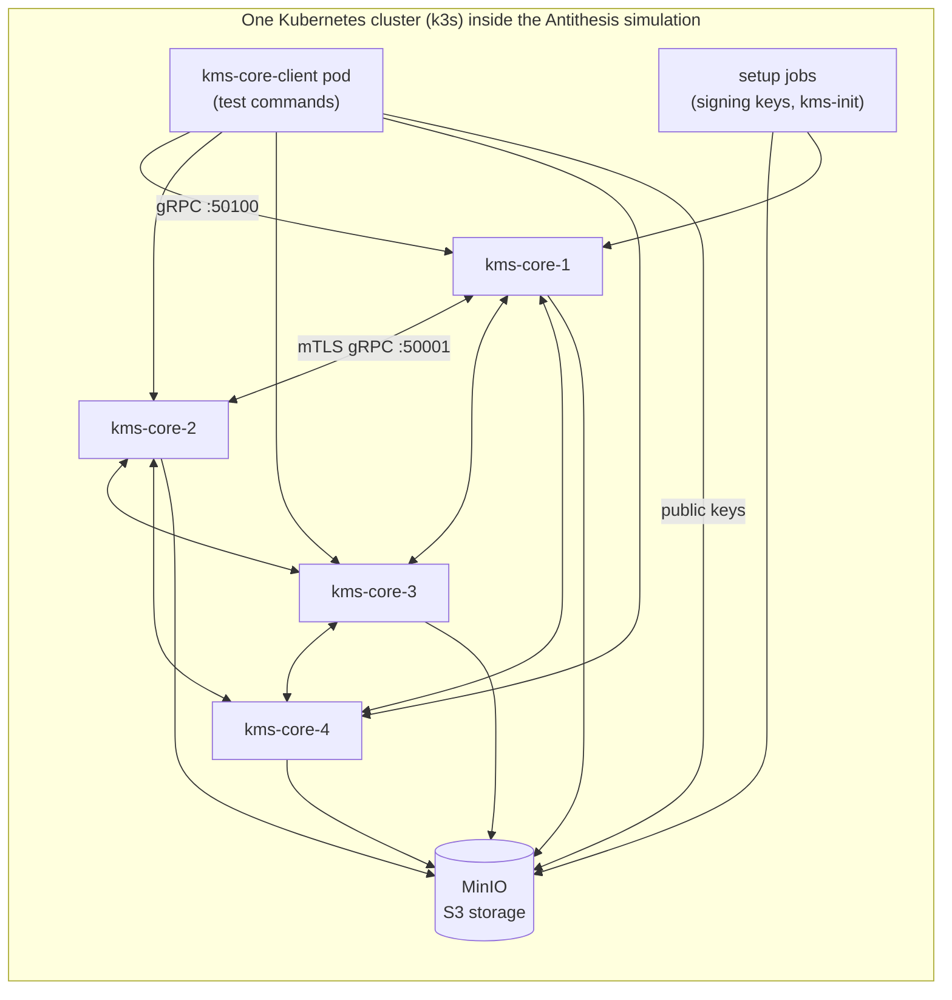

# Zama KMS under Antithesis: a new recovery bug found, a known one caught

**Prepared for:** Zama · **Tested:** 2026-10-17 to 2026-10-18 · **System:** Zama KMS v0.15.0-1, threshold mode ([`4a644c85`](https://github.com/zama-ai/kms/commit/4a644c8546abc8b002b7e45c19bf195996e7d229))

## Summary

We ran a four-party Zama KMS cluster on Kubernetes under Antithesis in test runs totalling about
31 hours, under simulated faults: network partitions and slowdowns, pod stops and kills, and clock jumps. The test
commands drove it the way an operator or the KMS connector would. We checked four guarantees:
correct public decryption ([Guarantee 1](#guarantee-1)), recovery once faults stop
([Guarantee 2](#guarantee-2)), key resharing ([Guarantee 3](#guarantee-3)) and correct user
decryption ([Guarantee 4](#guarantee-4)).

- **A new bug in the current version** breaks [Guarantee 2](#guarantee-2):
  [a core restarted during a brief storage outage can boot into recovery mode](#storage-error-enters-recovery-mode).
  Its read of its signing key fails with a network error, the boot treats that as a lost key,
  and the core then refuses every decryption until someone restarts it, while its health checks
  keep passing. The code is unchanged on the latest `main`. We propose a
  [small patch](../antithesis/fixes/storage-error-enters-recovery-mode.patch) with a unit test.
- **A known bug caught:** the same tests found the restarted-core bug Zama fixed in September
  2026 ([the known-bug check](#known-bug-check)) in both long runs on a build with that fix
  removed. An analysis done without access to the upstream fix reached the same root cause and a
  fix of the same kind, and that fix passed a check run.
- **Everything else held:** Guarantees 1, 3 and 4 held in every run on the current version.
- One crash during restarts is [worth a closer look](#worth-a-closer-look): a core sometimes
  can't bind its service port. It's unconfirmed.

## What we tested

- **Zama's system:** Zama KMS holds the secret key of the Zama Protocol's fully homomorphic
  encryption (FHE) as shares spread over independent parties. It decrypts or re-encrypts
  ciphertexts only when enough of the parties cooperate (threshold multi-party computation).
  Production runs 13 parties and tolerates 4 offline or malicious ones, and every decryption
  result is signed by each party.
- **Under test:** Zama KMS itself, built from source at upstream
  [`4a644c85`](https://github.com/zama-ai/kms/commit/4a644c8546abc8b002b7e45c19bf195996e7d229)
  with Antithesis coverage tracking (instrumentation) added. It's the `kms-server` cores every
  KMS operator runs and the `kms-core-client` that Zama's own docs use to drive them, deployed in
  threshold mode on Kubernetes. We scaled it from 13 parties with `t = 4` down to 4 parties with `t = 1`, the
  smallest cluster that survives one lost party.
- **How long:** 15 test runs, 31 hours of testing in total, from 2026-10-17 to
  2026-10-18. Each hour of testing explores many alternative histories of the cluster
  (timelines), so most checks ran thousands of times.

## Guarantees

The promises Zama makes about the KMS to its clients that we checked, in plain terms.

| Guarantee | Statement | Source | Result |
|---|---|---|---|
| [Guarantee 1](#guarantee-1) | Every public-decryption result a core signs carries exactly the plaintext that was encrypted, whichever single core crashes, restarts or is cut off (correctness under threshold robustness) | [Zama Protocol litepaper](https://docs.zama.org/protocol/zama-protocol-litepaper) | ✅ held |
| [Guarantee 2](#guarantee-2) | Once faults stop, every core accepts connections again within 600 s, and from then a public decryption answered by all four cores succeeds within 300 s (availability after recovery) | [KMS overview](https://docs.zama.org/protocol/protocol/overview/kms), [kms-server-bin.md](https://github.com/zama-ai/kms/blob/main/docs/guides/kms-server-bin.md) | ❌ broken once on the current version ([recovery mode](#storage-error-enters-recovery-mode)) · ❌ broken before the fix ([the known bug](#known-bug-check)) |
| [Guarantee 3](#guarantee-3) | Resharing the key into a new epoch while decryptions run keeps the same key: decryptions under the new epoch are correct, the public key doesn't change, and a failed reshare leaves the earlier epoch serving (key resharing) | [entry_points.md](https://github.com/zama-ai/kms/blob/main/docs/guides/entry_points.md#key-reshare) | ✅ held |
| [Guarantee 4](#guarantee-4) | Every user decryption the client reconstructs yields exactly the encrypted plaintext or an error, never a different value (correctness of threshold user decryption) | [trust_model.md](https://github.com/zama-ai/kms/blob/main/docs/explanations/trust_model.md) | ✅ held |
| [Guarantee 5](#guarantee-5) | Re-sending a decryption request under the same request ID is answered as documented (request-ID idempotency) | [trust_model.md](https://github.com/zama-ai/kms/blob/main/docs/explanations/trust_model.md) | ⏸ not tested (the stock client can't choose request IDs) |

### Guarantee 1: public decryption returns the encrypted plaintext

"Our MPC protocol is robust, meaning it will give a correct output with up to 1/3 malicious
nodes" ([litepaper](https://docs.zama.org/protocol/zama-protocol-litepaper)). The tests encrypt
random values of their own choosing, ask the cores to decrypt them, and check that every response
the client collects (two, or all four in some calls) carries exactly the encrypted value. They vary the FHE types, batches,
compression and synchronous or asynchronous calls, and use three or four cores. In the two 4-hour
runs on the current version, all 150,873 checked decryptions carried the right plaintext
([test commands](#test-commands)).

### Guarantee 2: the cluster serves decryptions again after faults stop

"It supports guaranteed output delivery even if some nodes are offline or misbehaving"
([KMS overview](https://docs.zama.org/protocol/protocol/overview/kms)), and a restarted node
re-joins "an existing set of nodes, without running `init` again"
([kms-server-bin.md](https://github.com/zama-ai/kms/blob/main/docs/guides/kms-server-bin.md)).
No recovery time is documented, so the windows are ours. 300 s is the deployed MPC
`network_timeout`. 600 s covers Kubernetes' restart back-off. After Antithesis stops all faults, a
command waits for every core to accept connections, then retries a fresh decryption that needs
all four cores' answers. On the current version this held in every one of the 17,280 recoveries
checked in the two 4-hour runs, including 202 where the first attempt failed and a later one
succeeded. It failed once on the current version, in a run with timing fuzzing:
[a core stuck in recovery mode](#storage-error-enters-recovery-mode). Before the known bug's fix it
failed in both long runs ([known-bug check](#known-bug-check)).

### Guarantee 3: resharing keeps the key

Resharing changes "the pseudorandom values that each party hold … but with the public key
remaining the same" ([entry_points.md](https://github.com/zama-ai/kms/blob/main/docs/guides/entry_points.md#key-reshare)).
While decryptions run and faults hit, a command reshares the key into a new epoch as an operator
would. It then checks that every party's published public key is unchanged and that decryptions
under the old and new epochs return the encrypted values. In the two 4-hour runs on the current
version, all 49,496 completed reshares, each checked against every core's result, matched the
reshared key, all 76,838 public-key checks found the key unchanged, and every decryption under a reshared or source epoch was correct.

### Guarantee 4: user decryption returns the encrypted plaintext

"Up to `t` of the `n` parties may be malicious, and the protocol still protects the secret key and
produces correct results" ([trust_model.md](https://github.com/zama-ai/kms/blob/main/docs/explanations/trust_model.md)).
The tests user-decrypt values they encrypted and check that every plaintext the client
reconstructs from the cores' encrypted shares equals the encrypted value. All 37,477
reconstructions in the two 4-hour runs on the current version were correct.

### Guarantee 5: retries under one request ID behave as documented

Not tested. The stock `kms-core-client` always picks a fresh random request ID and can't resend a
request byte for byte, and building a client that could didn't fit the time available. The
synchronous calls the tests make do resend the identical request when a core answers
"unavailable", so part of this path ran.

## How we tested

### Environment

- **Software under test:**
  - **Zama KMS** v0.15.0-1 (`kms-server`, `kms-core-client`, `kms-init`, `kms-gen-keys`):
    [`4a644c85`](https://github.com/zama-ai/kms/commit/4a644c8546abc8b002b7e45c19bf195996e7d229)
    ([zama-ai/kms](https://github.com/zama-ai/kms)).
  - Built from source with coverage instrumentation. Every build that ran is listed in
    [Builds](#builds).

*The four cores (one StatefulSet each) answer the client on port 50100 and run the MPC protocols
with each other over mutually authenticated TLS on port 50001. Each core keeps its key shares,
signing keys and certificates in its own MinIO prefix. Setup jobs generate the signing keys and
create the MPC context before testing starts (kms-init reaches all four cores; one arrow drawn).
The client pod runs every test command.*

- **Faults** (all from Antithesis; the test commands never cause one):
  - network partitions, one-way cuts, slowdowns and congestion between any pods;
  - pod stops (graceful deletion) and pod kills (immediate deletion) of the four cores, each
    kind about every 300 s (median) on a randomly chosen core. The client and MinIO pods are spared from pod faults, but not from network
    faults;
  - clock jumps;
  - thread pausing inside the instrumented KMS processes;
  - in some runs: faults in bursts separated by 60–120 s quiet windows (strobing), and fuzzed
    scheduling of the simulation's virtual time (timing fuzzing).
- **Workload:**
  - one FHE key, generated once, then public and user decryptions of fresh random values at
    random times, many in parallel;
  - key reshares into new epochs while those decryptions run;
  - every decryption checked against the value the command encrypted, so no shared record is
    needed;
  - shapes vary per timeline: three or four cores, synchronous or asynchronous calls, all four
    responses or a majority, batches, FHE types and compressed ciphertexts;
  - after faults stop, a recovery check that needs all four cores.

**How the tested setup differs from a default install:**

| Setting | Test value | Production default | Why |
|---|---|---|---|
| Cluster size | 4 parties, threshold `t = 1` | 13 parties, `t = 4` | smallest cluster that survives one lost party (n > 3t) |
| FHE parameters | `Test` | `Default` | each FHE operation takes milliseconds, so thousands run per timeline |
| Key generation | insecure single-party key generation | distributed key generation (hours) | gets a key in seconds; distributed key generation isn't exercised |
| Build and attestation | `insecure` feature, mock enclave, no release allowlist | AWS Nitro enclave with an allowlist of release measurements (PCR values) | runs outside AWS Nitro |
| Client `num_majority` / `num_reconstruct` | 2 / 3 | 5 / 9 | scaled to 4 parties (t + 1 and 2t + 1) |
| `num_sessions_preproc` | 2 | 100 | sized to the test machine |
| `num_rayon_threads` / `num_tokio_threads` | 8 / 2 | 40 / 10 | sized to the test machine |
| Rate limiter `bucket_size` | 51000 | 50000 | lets one preprocessing and one key generation hold tokens together |
| Core memory | request 2 GiB, limit 8 GiB | not set | fits the test machine |
| Client timeouts | decryption 300 s, reshare 900 s per attempt | none | bounds each test command |

The MPC network settings (`network_timeout` 300 s, retry back-off, session limits), the gRPC
timeouts and the health probes are the Helm chart's production values.

### Test commands

Five commands: one that generates the FHE key first, two drivers that decrypt at random times
while Antithesis injects faults, one that reshares the key during faults, and one checker after
faults stop. **How each one works, every check it makes, and where in the code:
[How the tests work](speedrun-tests.md).**

| Guarantee | What the commands do | Commands |
|---|---|---|
| [Guarantee 1](#guarantee-1) | Public-decrypt freshly encrypted random values through three or four cores, retrying when an attempt ends without a verdict; every response the client collects must carry the encrypted value | [`parallel_driver_public_decrypt.sh`](speedrun-tests.md#parallel_driver_public_decrypt), [`eventually_recovers_after_faults.sh`](speedrun-tests.md#eventually_recovers_after_faults) |
| [Guarantee 2](#guarantee-2) | After faults stop, wait for every core to accept connections (600 s), then retry a decryption needing all four cores until it succeeds (300 s) | [`eventually_recovers_after_faults.sh`](speedrun-tests.md#eventually_recovers_after_faults) |
| [Guarantee 3](#guarantee-3) | Reshare the key into a new epoch while decryptions run; the public key must not change, and decryptions under the new and old epochs must stay correct | [`anytime_reshare_key.sh`](speedrun-tests.md#anytime_reshare_key), [`parallel_driver_public_decrypt.sh`](speedrun-tests.md#parallel_driver_public_decrypt), [`parallel_driver_user_decrypt.sh`](speedrun-tests.md#parallel_driver_user_decrypt) |
| [Guarantee 4](#guarantee-4) | User-decrypt freshly encrypted random values; every reconstructed plaintext must equal the encrypted value | [`parallel_driver_user_decrypt.sh`](speedrun-tests.md#parallel_driver_user_decrypt) |

Before any command runs, Kubernetes jobs generate each party's signing keys into MinIO, and
`kms-init` creates the MPC context on all four cores ([manifest](../antithesis/config/manifests/40-kms-core-init.yaml)).
Then [`first_generate_key.sh`](speedrun-tests.md#first_generate_key) generates the key the other
commands use.

## Known-bug check

**The bug:** a core whose pod is killed and replaced can't help answer decryptions after it's back,
for longer than the tests' 5-minute window. Zama fixed it in [PR #887](https://github.com/zama-ai/kms/pull/887),
"detect dead peer connections with HTTP/2 keepalive", merged on 2026-09-25 as
[`a51d30be`](https://github.com/zama-ai/kms/commit/a51d30beeae0131a84c9875f62de3012ae3890f9). It
breaks [Guarantee 2](#guarantee-2). The fix ships after v0.14.

**The build before the fix:** the current version
[`4a644c85`](https://github.com/zama-ai/kms/commit/4a644c8546abc8b002b7e45c19bf195996e7d229) with
the fix's production changes reverted ([revert patch](../antithesis/patches/prefix/0001-revert-887-http2-keepalive.patch)),
rather than the fix's parent [`612207a9`](https://github.com/zama-ai/kms/commit/612207a9567702dd7251eaac3c812d250220880f).
That way the two builds differ only in the fix, and the tests, manifests and configuration stay
identical. The revert applies cleanly, and the reverted code matches the fix's parent on the bug's
path.

**Reproduced: yes.** Antithesis found it in both 4-hour runs on the build before the fix, with the default
fault set ([`52a8bf9b`](https://zama.antithesis.com/report/9eEE7zOFd9Dh9U3xoux0L-pj/QKG_cHLnNVVbOYWB0R0HlqKpRTSdfPqStnNZHN3dfPw.html?auth=v2.public.eyJzY29wZSI6eyJSZXBvcnRTY29wZVYxIjp7ImFzc2V0IjoiUUtHX2NITG5OVlZiT1lXQjBSMEhscUtwUlRTZGZQcVN0bk5aSE4zZGZQdy5odG1sIiwicmVwb3J0X2lkIjoiOWVFRTd6T0ZkOURoOVUzeG91eDBMLXBqIn19LCJuYmYiOiIyMDI2LTEwLTE4VDAzOjU5OjE0LjIyMjgwNjM3N1oifbWHfRwyY5SragY9QudsFg23eqGDVqsOLpO1QjjEXtewl5lI-gUwUNxI3o5onfIw34kyP6XqcyIcKwhz_FiQ4Qk),
118 failing examples) and with strobed faults ([`336b5b11`](https://zama.antithesis.com/report/Fll8Soc5kCDFTeEZp3ek17Ea/gZZGf9Vks_xaKy0EyS88AGlaJVfemscOEEYb6WG4vAs.html?auth=v2.public.eyJuYmYiOiIyMDI2LTEwLTE4VDA0OjAxOjQxLjY1NTk3MDU5M1oiLCJzY29wZSI6eyJSZXBvcnRTY29wZVYxIjp7ImFzc2V0IjoiZ1paR2Y5VmtzX3hhS3kwRXlTODhBR2xhSlZmZW1zY09FRVliNldHNHZBcy5odG1sIiwicmVwb3J0X2lkIjoiRmxsOFNvYzVrQ0RGVGVFWnAzZWsxN0VhIn19fYJapcfSFfD2FlJP98J-1mav97zxLbJd1AWPqbw3R4BFyC9CJe4Ma707fn9SKpmxAwnwRwWBuICXoowHTbT69wM),
41). The first failure came at 537 s of simulated time: faults stopped at 237 s, and
the recovery check then failed for its whole 300 s window. In 107 of the first run's 118 failing
examples and all 41 of the second's, the core that never answered was one restarted shortly
before faults stopped. The other 11 share one history, in which the stuck core hadn't restarted;
they weren't analysed. The current version passed the same check in every run with the same
faults. Its one failure there, under timing fuzzing, is a different bug: the restarted core
refused requests outright ([recovery mode](#storage-error-enters-recovery-mode)).

**What happened** ([first failure](https://zama.antithesis.com/search?search=v6veyJxIjp7Im4iOnsiciI6eyJoIjpbeyJoIjpbeyJjIjoibW9tZW50LnZ0aW1lIiwiZiI6ImdlbmVyYWwuY3VzdG9tIiwibyI6Im1hdGNoZXMiLCJ2IjoiNTM3LjI1Mzk2Njk4NTAzNzYifV0sIm8iOiJvciJ9LHsiaCI6W3siYyI6Im1vbWVudC5pbnB1dF9oYXNoIiwiZiI6ImdlbmVyYWwuY3VzdG9tIiwibyI6Im1hdGNoZXMiLCJ2IjoiLTEwNjQ3ODQzNjczMjcxMDc0ODIifV0sIm8iOiJvciJ9XSwibyI6ImFuZCJ9LCJ0Ijp7ImciOmZhbHNlLCJtIjoiIn0sInkiOiJub25lIn19LCJzIjoiMzY4NGYxZGZiNzQxNDY0MWE1ZGU4YWQ2OTRlMGNiZjctNjQtNCJ9)):
1. Antithesis kills the pod of `kms-core-1`, in this timeline while a partition cuts
   `kms-core-3` off. In the other run's first failure, a pod kill with no network fault active
   was enough.
2. Kubernetes starts a replacement, and faults stop two seconds later. The new core is up within
   seconds and accepts client connections.
3. A fresh public decryption reaches all four cores. Three finish in about 40 ms. The restarted
   core never finishes and answers "not done yet" to every poll.
4. Two more attempts within the 300 s window go the same way, and the check fails. No core logs an error.

**Root cause** ([full analysis](../antithesis/scratchbook/rca/decryption-stalls-after-core-restart.md)):
each core reuses one gRPC connection per peer for all MPC messages, and before the fix nothing
checked that the connection was alive. The analysis infers from the code, and upstream's
description of the fix agrees, that when a pod dies and its peers never see the connection close,
they keep writing the restarted core's messages into a dead connection. Those sends neither
succeed nor fail, so the retry logic never runs and the channel never reconnects. The restarted
core waits for shares that never arrive. Its three peers have enough shares among themselves, so
they finish. This analysis was done without access to the upstream fix, its tests or its
history. It reached the same mechanism, and its [proposed patch](../antithesis/fixes/decryption-stalls-after-core-restart.patch)
adds HTTP/2 keep-alive pings, also while idle, to both peer channel builders, as the upstream fix
does. The patch also adds a 30 s connection timeout. The
[comparison with the upstream fix](../antithesis/scratchbook/rca/decryption-stalls-after-core-restart.md#comparison-with-upstream)
lists the differences. **The fix check passed:** with the patch applied to the build before the fix, a 120-minute run with the same faults ([`a7167532`](https://zama.antithesis.com/report/E3aRgfAZx0FG9ubZyK2gLIoR/WOfMjnEReqZRagmPUuWwUHPDAjmwjhtZw3u5U5iRSuU.html?auth=v2.public.eyJuYmYiOiIyMDI2LTEwLTE4VDA4OjA5OjE5LjE3MjY0NjYxM1oiLCJzY29wZSI6eyJSZXBvcnRTY29wZVYxIjp7ImFzc2V0IjoiV09mTWpuRVJlcVpSYWdtUFV1V3dVSFBEQWptd2podFp3M3U1VTVpUlN1VS5odG1sIiwicmVwb3J0X2lkIjoiRTNhUmdmQVp4MEZHOXViWnlLMmdMSW9SIn19feJnQdPR6ASOY1JTnB5-6WNI3-5xqJfWurzelFpKrcEWWRqdnjJ2gCtotLkMWQ5e1aqAmMFoC5nDcB466sYCTwU)) passed Guarantee 2 in all 6,934 checks. Before the fix, 118 of 8,424 checks (1.4 %) failed in the run with the same faults, so about 97 failures would have been expected; none occurred. Both of the check's harder recovery cases came up: a core the client couldn't reach after faults stopped came back (87 times), and a decryption that failed its first attempt then succeeded (116 times).

## Findings

One new finding on the current version, in 7 long runs and about 19 hours of
hunting under the full fault set, plus 5 shorter runs while the tests were being built.

### A storage error while a core boots leaves it in recovery mode, refusing every decryption

[Full analysis](../antithesis/scratchbook/rca/storage-error-enters-recovery-mode.md) · [proposed patch](../antithesis/fixes/storage-error-enters-recovery-mode.patch)

**What broke:** [Guarantee 2](#guarantee-2). A core that restarts while its storage (S3, here
MinIO) is briefly unreachable can boot into recovery mode, the mode meant for restoring a wiped
node from custodian backups. It then refuses every public and user decryption until someone
restarts it. Its health checks keep passing, so Kubernetes never restarts it.

**Impact:** the cluster silently loses a party for as long as nobody restarts it. Here the other three cores
still answered every decryption, so clients kept getting results, but the cluster ran one more
failure away from an outage, with only a warning in that core's log to show for it. A production
cluster (13 parties, 4 may be lost) has more slack, but each occurrence uses some of it up until
an operator notices.

**How it happened** ([first failure](https://zama.antithesis.com/search?search=v6veyJxIjp7Im4iOnsiciI6eyJoIjpbeyJoIjpbeyJjIjoibW9tZW50LnZ0aW1lIiwiZiI6ImdlbmVyYWwuY3VzdG9tIiwibyI6Im1hdGNoZXMiLCJ2IjoiMTQwNS41NTYxNDgyMjQ1MTAzIn1dLCJvIjoib3IifSx7ImgiOlt7ImMiOiJtb21lbnQuaW5wdXRfaGFzaCIsImYiOiJnZW5lcmFsLmN1c3RvbSIsIm8iOiJtYXRjaGVzIiwidiI6Ii03MzUzOTUwNjk0OTIwNzU0NjQ3In1dLCJvIjoib3IifV0sIm8iOiJhbmQifSwidCI6eyJnIjpmYWxzZSwibSI6IiJ9LCJ5Ijoibm9uZSJ9fSwicyI6Ijg4Y2ViMWFkZDZiMDM3YjQyNTQ4Yjk4ZTc5OTU4M2U0LTY0LTQifQ)):
1. Antithesis kills the pod of `kms-core-2` while network faults are active. The replacement boots
   slowly under the faults, reading its keys from storage.
2. A 6.7 s partition cuts the cores off from MinIO. The core's read of its signing key fails with a
   network error ("dispatch failure"), although the key is there: the same boot read it about 170 s
   earlier, and read it again 11 s later.
3. The boot treats the error as a lost key: "SIGNING KEY NOT AVAILABLE, ENTERING RECOVERY MODE!!!!".
4. Faults stop. All four cores accept connections, but for the whole 5-minute window `kms-core-2`
   refuses all 27 decryptions with "Signing key is not present. This should only happen when server
   is booted in recovery mode" (gRPC code 9), while the other three cores decrypt and sign each one.

**How often:** one failing check, in a 105-minute run with timing fuzzing
([`4e338bff`](https://zama.antithesis.com/report/z0DpS4BEFi0AtQY_3k2xQYil/WNeeUiIs3qYUlUd7UAiS1YdNQh8HKvhl2ofzq82Afa8.html?auth=v2.public.eyJuYmYiOiIyMDI2LTEwLTE4VDA3OjA0OjQzLjEwMjAyODEzMloiLCJzY29wZSI6eyJSZXBvcnRTY29wZVYxIjp7ImFzc2V0IjoiV05lZVVpSXMzcVlVbFVkN1VBaVMxWWROUWg4SEt2aGwyb2Z6cTgyQWZhOC5odG1sIiwicmVwb3J0X2lkIjoiejBEcFM0QkVGaTBBdFFZXzNrMnhRWWlsIn19fZI8ndKJGsf6_PbNOmcRvP7XRP6CnD-8mfcqZYL0UYS8iuH35ePerg9wy7HvBDKR8Y_jV7R5W-saZjsBZoGotAo)). In a 4-hour run without timing fuzzing
([`8196fb3c`](https://zama.antithesis.com/report/RQ8Cbp-xGNyv2LzRK7QJhdaS/Q4j24Mga4r9vKq6G1GGKGJhmWP0f7ZtlCtPmgF4J-dU.html?auth=v2.public.eyJzY29wZSI6eyJSZXBvcnRTY29wZVYxIjp7ImFzc2V0IjoiUTRqMjRNZ2E0cjl2S3E2RzFHR0tHSmhtV1AwZjdadGxDdFBtZ0Y0Si1kVS5odG1sIiwicmVwb3J0X2lkIjoiUlE4Q2JwLXhHTnl2Mkx6Uks3UUpoZGFTIn19LCJuYmYiOiIyMDI2LTEwLTE4VDAzOjUyOjUyLjkwNzU2NjUzOVoiffXOyyh90TorAK1eQ08RnDaqV3Hiuf4ZXbyxANa4Qh-8Ku_qk3g7JPpHFH0alZBWKDgpmQ1bzWKzpgv7_81JSwI)), `kms-core-1` entered recovery mode the same way, but no
decryption reached it while it was in that mode. Across those two runs the signing-key read failed
at boot 5 times. The 3 failures in an earlier boot step ended the process, which Kubernetes restarted.
The 2 failures in this step left the core in recovery mode. The same run's other 47 failing
examples of the check come from a stall of the test machine, not from the KMS
([review](../antithesis/scratchbook/false-positives.md#recovery-check-attempt-outlives-timeout)).

**Root cause:** [`boot_base_kms`](https://github.com/zama-ai/kms/blob/4a644c8546abc8b002b7e45c19bf195996e7d229/core/service/src/engine/backup_operator.rs#L850-L872) sends every error from loading
the signing identity into the recovery-mode branch. An empty key folder, a failed listing and a
failed read all come back as the same error, so a network blip looks like a lost key. Other
boot-time storage errors end the process, including the same read a few steps earlier in the
migration check ([`migration.rs`](https://github.com/zama-ai/kms/blob/4a644c8546abc8b002b7e45c19bf195996e7d229/core/service/src/engine/migration.rs#L242-L252)), which asks whether the key exists
first. A node in recovery mode loads its identity only at boot, so it stays that way.

**Proposed fix** ([details](../antithesis/scratchbook/rca/storage-error-enters-recovery-mode.md#fix)):
when loading the signing key fails, list the key folder and enter recovery mode only if it's
empty; otherwise fail the boot, so Kubernetes retries it once storage answers. Checked by its unit test, which fails without the fix and passes with it; every test in `engine::backup_operator` and every test with "recovery" in its name passes (50 of 50, including the new one), as do all 23 custodian backup-recovery tests. It wasn't checked in an Antithesis run: the bug showed up at most once per run, and a run long enough to tell wouldn't have reported in time ([how it was checked](../antithesis/scratchbook/rca/storage-error-enters-recovery-mode.md#fix)).

**Known upstream:** not that we found, and the code is unchanged on the latest `main`
([`f0258b8a`](https://github.com/zama-ai/kms/blob/f0258b8ade070f33e574e7ffde96988b0e94649a/core/service/src/engine/backup_operator.rs#L850-L872),
2026-10-16). The pull request that added recovery mode ([#468](https://github.com/zama-ai/kms/pull/468))
describes it for a node started with empty private storage
([comparison](../antithesis/scratchbook/rca/storage-error-enters-recovery-mode.md#comparison-with-upstream)).

## Worth a closer look (unconfirmed)

### A restarting core sometimes can't bind its service port

**Unconfirmed:** the crash is real and recurs, but the logs don't show what holds the port.
- **What was seen:** a core restarting after a pod stop or a boot failure panics with
  `Could not bind to 0.0.0.0:50100 … AddrInUse`
  ([`kms-server.rs:594`](https://github.com/zama-ai/kms/blob/4a644c8546abc8b002b7e45c19bf195996e7d229/core/service/src/bin/kms-server.rs#L594))
  and exits. In one timeline the port stayed taken across four starts in a row (the first and
  three restarts), for at least 43 s. Seen in 5 runs: 3 failing examples in
  [`5a41ff45`](https://zama.antithesis.com/report/osAjr9BLYLHEbb3IXrirMKfU/qdH-RmNnyHthMKXV3T627ycFlSEFwwyqREKpQLF2ubI.html?auth=v2.public.eyJuYmYiOiIyMDI2LTEwLTE3VDIyOjI1OjU5LjI2NDI5NTMxN1oiLCJzY29wZSI6eyJSZXBvcnRTY29wZVYxIjp7ImFzc2V0IjoicWRILVJtTm55SHRoTUtYVjNUNjI3eWNGbFNFRnd3eXFSRUtwUUxGMnViSS5odG1sIiwicmVwb3J0X2lkIjoib3NBanI5QkxZTEhFYmIzSVhyaXJNS2ZVIn19fQfTp_Ex_1v8uV3QyajJ48Jw4HdyV1V3iprMM6sstjw5ZFUtGkmL2zv2RRGsRUfBLF_DjYhQu6Kd2hTVvfZU1wU),
  150 in [`bbb951cd`](https://zama.antithesis.com/report/RrQpUXYBRSznhOom3OWSsVwm/GOczSuL6QWj7Sl9UX46ZavqUH-q6DwiQt8cf-yXoqwA.html?auth=v2.public.eyJuYmYiOiIyMDI2LTEwLTE4VDAzOjU2OjAzLjUzMjQyMjgxMVoiLCJzY29wZSI6eyJSZXBvcnRTY29wZVYxIjp7ImFzc2V0IjoiR09jelN1TDZRV2o3U2w5VVg0NlphdnFVSC1xNkR3aVF0OGNmLXlYb3F3QS5odG1sIiwicmVwb3J0X2lkIjoiUnJRcFVYWUJSU3puaE9vbTNPV1NzVndtIn19fV6KMVLXfgSv3BN0DgMakXVvvIoEAi2-twEk9HZOqycO8BOfEEsMjOAaYl8MgRQlvNNY0l4DDvldF3EVrgJg9A4),
  155 in [`4e338bff`](https://zama.antithesis.com/report/z0DpS4BEFi0AtQY_3k2xQYil/WNeeUiIs3qYUlUd7UAiS1YdNQh8HKvhl2ofzq82Afa8.html?auth=v2.public.eyJuYmYiOiIyMDI2LTEwLTE4VDA3OjA0OjQzLjEwMjAyODEzMloiLCJzY29wZSI6eyJSZXBvcnRTY29wZVYxIjp7ImFzc2V0IjoiV05lZVVpSXMzcVlVbFVkN1VBaVMxWWROUWg4SEt2aGwyb2Z6cTgyQWZhOC5odG1sIiwicmVwb3J0X2lkIjoiejBEcFM0QkVGaTBBdFFZXzNrMnhRWWlsIn19fZI8ndKJGsf6_PbNOmcRvP7XRP6CnD-8mfcqZYL0UYS8iuH35ePerg9wy7HvBDKR8Y_jV7R5W-saZjsBZoGotAo),
  115 in [`f138c07c`](https://zama.antithesis.com/report/fGBWatltHprLF20S9ngnf_Xx/axTAE2jgHdQBkKrbRNM9KwkMvW5_QmpoTc8LDOpxSOY.html?auth=v2.public.eyJuYmYiOiIyMDI2LTEwLTE4VDA5OjIwOjExLjc0ODYwNzIxOFoiLCJzY29wZSI6eyJSZXBvcnRTY29wZVYxIjp7ImFzc2V0IjoiYXhUQUUyamdIZFFCa0tyYlJOTTlLd2tNdlc1X1FtcG9UYzhMRE9weFNPWS5odG1sIiwicmVwb3J0X2lkIjoiZkdCV2F0bHRIcHJMRjIwUzluZ25mX1h4In19fW3zT4lKIsk7YZnr70bN1tmOm4j8MTfQ6Vdl27XtDiq70F1RB_57_1SoZ7QUNY07jsf_7-ZuPmZontnlKcNVKQ4)
  and 8 in [`9f7fa3b1`](https://zama.antithesis.com/report/o8xNfnvPNgTUfOskOctLnlkS/-F82X7-TJYyvoHCWd5I-9QkUhYMCmCi2ouiS5N_b-eM.html?auth=v2.public.eyJzY29wZSI6eyJSZXBvcnRTY29wZVYxIjp7ImFzc2V0IjoiLUY4Mlg3LVRKWXl2b0hDV2Q1SS05UWtVaFlNQ21DaTJvdWlTNU5fYi1lTS5odG1sIiwicmVwb3J0X2lkIjoibzh4TmZudlBOZ1RVZk9za09jdExubGtTIn19LCJuYmYiOiIyMDI2LTEwLTE4VDA5OjM5OjE0LjExNTgwODU2M1oifZQTX0mC0s_eteptEa4dnjKUBSq7S1eeAtwcWmKF67SGnjmZE3uBvhjqT5bzEYFf9J4j7rxMcCA2c-dR621ggQE)
  (as "No unexpected container exits", exit code 101). No guarantee failed because of it: the core
  came back once the port was free.
- **Likely cause:** before binding 50100, a booting core and its init containers make dozens of
  outgoing requests to MinIO. 50100 lies inside Linux's default range for outgoing ports
  (32768–60999). If one of those connections gets local port 50100 and the pod's side closes it
  first, the port stays in `TIME_WAIT` for 60 s, and Linux refuses a listener on it. A local test reproduces exactly this
  error ([check](../antithesis/scratchbook/probes/boot-panic-port-in-use/tw-bind-check.md)).
  The Helm chart's production port is also 50100.
- **The doubt:** no socket listing exists for the failing moment, so the holder isn't proven.
- **What would settle it:** list the pod's sockets (`ss -tan`) at the next occurrence. If
  confirmed, reserving the service ports for the pod (`net.ipv4.ip_local_reserved_ports`) would
  avoid it. Binding kms-server's listeners before its own first outgoing connection would only
  cover kms-server's connections, not those of the init containers.

## Scope and limits

- **Not tested:** [Guarantee 5](#guarantee-5) (request-ID retries), which needs a client that can
  resend a request under the same ID.
- **Crash, restart, partition and clock faults only.** Every core ran honest code: a core that
  lies (Byzantine behaviour), the case the MPC protocol is designed for, isn't covered.
- **A smaller, faster configuration than production:** 4 parties instead of 13, `Test` FHE
  parameters, insecure key generation and a mock enclave ([table](#environment)). Distributed key
  generation and preprocessing weren't exercised.
- **One MinIO instance, spared from pod faults.** Network faults did reach it. Storage outages
  at boot make a core exit and restart, which Kubernetes handles; we treated that as designed.
  The exception is the signing-key read, the [new finding](#storage-error-enters-recovery-mode).
- **No disk faults or CPU starvation:** the launcher doesn't inject disk faults, and CPU
  starvation was left off because it interacts with the KMS's own timeouts.
- **Memory:** in every 4-hour run, memory use passed 95 % of the test machine's 9.7 GiB
  (Antithesis's "Peak memory usage" warning) while hundreds of test commands were waiting during
  faults. Both runs with a 16 GiB test machine passed that check ([`6111d172`](https://zama.antithesis.com/report/P1OrdTOwOQhvk1Bda_x3yATq/6G9cywvyWShFE6lQzOi0RmoaJzzoiArwrA7fpzOnKiU.html?auth=v2.public.eyJzY29wZSI6eyJSZXBvcnRTY29wZVYxIjp7ImFzc2V0IjoiNkc5Y3l3dnlXU2hGRTZsUXpPaTBSbW9hSnp6b2lBcndyQTdmcHpPbktpVS5odG1sIiwicmVwb3J0X2lkIjoiUDFPcmRUT3dPUWh2azFCZGFfeDN5QVRxIn19LCJuYmYiOiIyMDI2LTEwLTE4VDA3OjA4OjUyLjM1MjQ2MTQ4Mloifcvim4mQHGuO4yuywJaNWaRVq1skn9a4_E1eXUtmVC_gVSCCpxteSZeLsyy0z01YAT6E2l37bGY50_RmzPPTgwM) with the same faults, [`9f7fa3b1`](https://zama.antithesis.com/report/o8xNfnvPNgTUfOskOctLnlkS/-F82X7-TJYyvoHCWd5I-9QkUhYMCmCi2ouiS5N_b-eM.html?auth=v2.public.eyJzY29wZSI6eyJSZXBvcnRTY29wZVYxIjp7ImFzc2V0IjoiLUY4Mlg3LVRKWXl2b0hDV2Q1SS05UWtVaFlNQ21DaTJvdWlTNU5fYi1lTS5odG1sIiwicmVwb3J0X2lkIjoibzh4TmZudlBOZ1RVZk9za09jdExubGtTIn19LCJuYmYiOiIyMDI2LTEwLTE4VDA5OjM5OjE0LjExNTgwODU2M1oifZQTX0mC0s_eteptEa4dnjKUBSq7S1eeAtwcWmKF67SGnjmZE3uBvhjqT5bzEYFf9J4j7rxMcCA2c-dR621ggQE) with timing fuzzing added), and every run of 2 hours or more on the default machine failed it, so the test machine was too small for that backlog. A 105-minute run on the default machine also passed, and the 16 GiB runs were 105 and 125 minutes, so a slow leak isn't ruled out.

## Appendix

### Runs

Every run that contributed to these results. Report links carry an access token: anyone with the
link can open the report. Log links open the Antithesis logs explorer, and need a tenant login.

| Run | Purpose | Build | Length | Result |
|---|---|---|---|---|
| [`89e114d4`](https://zama.antithesis.com/report/ilG2W2eWtahE0MgFCM13ilUk/nBs_rWnrBYj49XFAHGNeCJoa2oeSD6hZxnAfR42DeIE.html?auth=v2.public.eyJuYmYiOiIyMDI2LTEwLTE3VDIwOjI4OjA3LjA2MDYyNjI2M1oiLCJzY29wZSI6eyJSZXBvcnRTY29wZVYxIjp7ImFzc2V0IjoibkJzX3JXbnJCWWo0OVhGQUhHTmVDSm9hMm9lU0Q2aFp4bkFmUjQyRGVJRS5odG1sIiwicmVwb3J0X2lkIjoiaWxHMlcyZVd0YWhFME1nRkNNMTNpbFVrIn19fds1Wp-y5Jgw079ePKBsYsHQIOAWfzdmjCCnJzav3zeVdEZvRnq1RrY4e_Ea8-TXpWHSH0RtQmXY0drVL_o5lQg) | setup check | [current](#builds) | 15 min | cluster and first tests ran |
| [`d886f1ac`](https://zama.antithesis.com/report/i9QvVQsNUV3lWeROzE30qG3G/YGlP1gzJvu1YGvvnc5gFTZMAddJga9xKGZuRd7-K0hw.html?auth=v2.public.eyJuYmYiOiIyMDI2LTEwLTE3VDIxOjE3OjE4LjI3MzMxNjI2MloiLCJzY29wZSI6eyJSZXBvcnRTY29wZVYxIjp7ImFzc2V0IjoiWUdsUDFnekp2dTFZR3Z2bmM1Z0ZUWk1BZGRKZ2E5eEtHWnVSZDctSzBody5odG1sIiwicmVwb3J0X2lkIjoiaTlRdlZRc05VVjNsV2VST3pFMzBxRzNHIn19fepgRllfmZncOVYFOd51epaITiFiUjGu3PlmgPn9wWx1mLwq-qLcGnKECPOyVSDkASL6IBKxeaNgUpgFDAdSLA0) | test iteration, network faults | [current](#builds) | 30 min | all guarantee checks held (two coverage markers that need pod faults weren't reached, which the Antithesis report lists as failing) |
| [`8bce7ea4`](https://zama.antithesis.com/report/44bMN2ghOV9ZTAc83HSRfKnO/96r6fNvaA5d6LUw5ajYS_fztx_3SlavhPmibaUEBBjQ.html?auth=v2.public.eyJzY29wZSI6eyJSZXBvcnRTY29wZVYxIjp7ImFzc2V0IjoiOTZyNmZOdmFBNWQ2TFV3NWFqWVNfZnp0eF8zU2xhdmhQbWliYVVFQkJqUS5odG1sIiwicmVwb3J0X2lkIjoiNDRiTU4yZ2hPVjlaVEFjODNIU1JmS25PIn19LCJuYmYiOiIyMDI2LTEwLTE3VDIyOjExOjQ5Ljc3OTUzNTgyN1oifSgqXMK1usZRwMye-_c4lZtMhUnajeS9S-m1KD51UoAdMwpsw4RopSB7vyLGKcKKHn_ojzZUOKHK_JyEPi37cAw) | test iteration, adds pod kills | [current](#builds) | 30 min | all guarantee checks held (a recovery coverage marker wasn't reached, which the Antithesis report lists as failing) |
| [`5a41ff45`](https://zama.antithesis.com/report/osAjr9BLYLHEbb3IXrirMKfU/qdH-RmNnyHthMKXV3T627ycFlSEFwwyqREKpQLF2ubI.html?auth=v2.public.eyJuYmYiOiIyMDI2LTEwLTE3VDIyOjI1OjU5LjI2NDI5NTMxN1oiLCJzY29wZSI6eyJSZXBvcnRTY29wZVYxIjp7ImFzc2V0IjoicWRILVJtTm55SHRoTUtYVjNUNjI3eWNGbFNFRnd3eXFSRUtwUUxGMnViSS5odG1sIiwicmVwb3J0X2lkIjoib3NBanI5QkxZTEhFYmIzSVhyaXJNS2ZVIn19fQfTp_Ex_1v8uV3QyajJ48Jw4HdyV1V3iprMM6sstjw5ZFUtGkmL2zv2RRGsRUfBLF_DjYhQu6Kd2hTVvfZU1wU) | test iteration, all four guarantees | [current](#builds) | 30 min | all guarantee checks held (a recovery coverage marker wasn't reached, which the Antithesis report lists as failing); [port crash](#boot-panic-port-in-use) first seen |
| [`63908ef2`](https://zama.antithesis.com/report/DgQ4uIHChAmsytQJtPrXPQDb/yPjTJtmZAM_112M-SSCbQk4uO9AN3vqOJ1_evjj1u1A.html?auth=v2.public.eyJzY29wZSI6eyJSZXBvcnRTY29wZVYxIjp7ImFzc2V0IjoieVBqVEp0bVpBTV8xMTJNLVNTQ2JRazR1TzlBTjN2cU9KMV9ldmpqMXUxQS5odG1sIiwicmVwb3J0X2lkIjoiRGdRNHVJSENoQW1zeXRRSnRQclhQUURiIn19LCJuYmYiOiIyMDI2LTEwLTE3VDIzOjIwOjU1LjY0MTU1ODE4MFoifR1-46AAkqn4ZQ-dZa71vHM-dAwh9nGO_Tygp74fX6RNriNTp1uIFeFv9z8vEpT_ka5h0N_NjbSgVVNwI4KCSgc) | test iteration, full fault set | [current](#builds) | 30 min | all guarantee checks held (two recovery coverage markers weren't reached, which the Antithesis report lists as failing) |
| [`8196fb3c`](https://zama.antithesis.com/report/RQ8Cbp-xGNyv2LzRK7QJhdaS/Q4j24Mga4r9vKq6G1GGKGJhmWP0f7ZtlCtPmgF4J-dU.html?auth=v2.public.eyJzY29wZSI6eyJSZXBvcnRTY29wZVYxIjp7ImFzc2V0IjoiUTRqMjRNZ2E0cjl2S3E2RzFHR0tHSmhtV1AwZjdadGxDdFBtZ0Y0Si1kVS5odG1sIiwicmVwb3J0X2lkIjoiUlE4Q2JwLXhHTnl2Mkx6Uks3UUpoZGFTIn19LCJuYmYiOiIyMDI2LTEwLTE4VDAzOjUyOjUyLjkwNzU2NjUzOVoiffXOyyh90TorAK1eQ08RnDaqV3Hiuf4ZXbyxANa4Qh-8Ku_qk3g7JPpHFH0alZBWKDgpmQ1bzWKzpgv7_81JSwI) | long hunt, full fault set | [current](#builds) | 240 min | all guarantees held |
| [`bbb951cd`](https://zama.antithesis.com/report/RrQpUXYBRSznhOom3OWSsVwm/GOczSuL6QWj7Sl9UX46ZavqUH-q6DwiQt8cf-yXoqwA.html?auth=v2.public.eyJuYmYiOiIyMDI2LTEwLTE4VDAzOjU2OjAzLjUzMjQyMjgxMVoiLCJzY29wZSI6eyJSZXBvcnRTY29wZVYxIjp7ImFzc2V0IjoiR09jelN1TDZRV2o3U2w5VVg0NlphdnFVSC1xNkR3aVF0OGNmLXlYb3F3QS5odG1sIiwicmVwb3J0X2lkIjoiUnJRcFVYWUJSU3puaE9vbTNPV1NzVndtIn19fV6KMVLXfgSv3BN0DgMakXVvvIoEAi2-twEk9HZOqycO8BOfEEsMjOAaYl8MgRQlvNNY0l4DDvldF3EVrgJg9A4) | long hunt, strobed faults | [current](#builds) | 240 min | all guarantees held; [port crash](#boot-panic-port-in-use) |
| [`52a8bf9b`](https://zama.antithesis.com/report/9eEE7zOFd9Dh9U3xoux0L-pj/QKG_cHLnNVVbOYWB0R0HlqKpRTSdfPqStnNZHN3dfPw.html?auth=v2.public.eyJzY29wZSI6eyJSZXBvcnRTY29wZVYxIjp7ImFzc2V0IjoiUUtHX2NITG5OVlZiT1lXQjBSMEhscUtwUlRTZGZQcVN0bk5aSE4zZGZQdy5odG1sIiwicmVwb3J0X2lkIjoiOWVFRTd6T0ZkOURoOVUzeG91eDBMLXBqIn19LCJuYmYiOiIyMDI2LTEwLTE4VDAzOjU5OjE0LjIyMjgwNjM3N1oifbWHfRwyY5SragY9QudsFg23eqGDVqsOLpO1QjjEXtewl5lI-gUwUNxI3o5onfIw34kyP6XqcyIcKwhz_FiQ4Qk) | known-bug check, full fault set | [before the fix](#builds) | 240 min | [Guarantee 2](#guarantee-2) broken: [the known bug](#known-bug-check) |
| [`336b5b11`](https://zama.antithesis.com/report/Fll8Soc5kCDFTeEZp3ek17Ea/gZZGf9Vks_xaKy0EyS88AGlaJVfemscOEEYb6WG4vAs.html?auth=v2.public.eyJuYmYiOiIyMDI2LTEwLTE4VDA0OjAxOjQxLjY1NTk3MDU5M1oiLCJzY29wZSI6eyJSZXBvcnRTY29wZVYxIjp7ImFzc2V0IjoiZ1paR2Y5VmtzX3hhS3kwRXlTODhBR2xhSlZmZW1zY09FRVliNldHNHZBcy5odG1sIiwicmVwb3J0X2lkIjoiRmxsOFNvYzVrQ0RGVGVFWnAzZWsxN0VhIn19fYJapcfSFfD2FlJP98J-1mav97zxLbJd1AWPqbw3R4BFyC9CJe4Ma707fn9SKpmxAwnwRwWBuICXoowHTbT69wM) | known-bug check, strobed faults | [before the fix](#builds) | 240 min | [Guarantee 2](#guarantee-2) broken: [the known bug](#known-bug-check) |
| [`4e338bff`](https://zama.antithesis.com/report/z0DpS4BEFi0AtQY_3k2xQYil/WNeeUiIs3qYUlUd7UAiS1YdNQh8HKvhl2ofzq82Afa8.html?auth=v2.public.eyJuYmYiOiIyMDI2LTEwLTE4VDA3OjA0OjQzLjEwMjAyODEzMloiLCJzY29wZSI6eyJSZXBvcnRTY29wZVYxIjp7ImFzc2V0IjoiV05lZVVpSXMzcVlVbFVkN1VBaVMxWWROUWg4SEt2aGwyb2Z6cTgyQWZhOC5odG1sIiwicmVwb3J0X2lkIjoiejBEcFM0QkVGaTBBdFFZXzNrMnhRWWlsIn19fZI8ndKJGsf6_PbNOmcRvP7XRP6CnD-8mfcqZYL0UYS8iuH35ePerg9wy7HvBDKR8Y_jV7R5W-saZjsBZoGotAo) | long hunt, full fault set plus timing fuzzing | [current](#builds) | 105 min | [Guarantee 2](#guarantee-2) broken once: [a core stuck in recovery mode](#storage-error-enters-recovery-mode); test-machine stalls; [port crash](#boot-panic-port-in-use) |
| [`6111d172`](https://zama.antithesis.com/report/P1OrdTOwOQhvk1Bda_x3yATq/6G9cywvyWShFE6lQzOi0RmoaJzzoiArwrA7fpzOnKiU.html?auth=v2.public.eyJzY29wZSI6eyJSZXBvcnRTY29wZVYxIjp7ImFzc2V0IjoiNkc5Y3l3dnlXU2hGRTZsUXpPaTBSbW9hSnp6b2lBcndyQTdmcHpPbktpVS5odG1sIiwicmVwb3J0X2lkIjoiUDFPcmRUT3dPUWh2azFCZGFfeDN5QVRxIn19LCJuYmYiOiIyMDI2LTEwLTE4VDA3OjA4OjUyLjM1MjQ2MTQ4Mloifcvim4mQHGuO4yuywJaNWaRVq1skn9a4_E1eXUtmVC_gVSCCpxteSZeLsyy0z01YAT6E2l37bGY50_RmzPPTgwM) | long hunt, full fault set, 16 GiB test machine | [current](#builds) | 105 min | all guarantees held; memory warning gone |
| [`a7167532`](https://zama.antithesis.com/report/E3aRgfAZx0FG9ubZyK2gLIoR/WOfMjnEReqZRagmPUuWwUHPDAjmwjhtZw3u5U5iRSuU.html?auth=v2.public.eyJuYmYiOiIyMDI2LTEwLTE4VDA4OjA5OjE5LjE3MjY0NjYxM1oiLCJzY29wZSI6eyJSZXBvcnRTY29wZVYxIjp7ImFzc2V0IjoiV09mTWpuRVJlcVpSYWdtUFV1V3dVSFBEQWptd2podFp3M3U1VTVpUlN1VS5odG1sIiwicmVwb3J0X2lkIjoiRTNhUmdmQVp4MEZHOXViWnlLMmdMSW9SIn19feJnQdPR6ASOY1JTnB5-6WNI3-5xqJfWurzelFpKrcEWWRqdnjJ2gCtotLkMWQ5e1aqAmMFoC5nDcB466sYCTwU) | fix check for the known bug, full fault set | [fix check](#builds) | 120 min | [Guarantee 2](#guarantee-2) held: [the fix works](#known-bug-check) |
| [`f138c07c`](https://zama.antithesis.com/report/fGBWatltHprLF20S9ngnf_Xx/axTAE2jgHdQBkKrbRNM9KwkMvW5_QmpoTc8LDOpxSOY.html?auth=v2.public.eyJuYmYiOiIyMDI2LTEwLTE4VDA5OjIwOjExLjc0ODYwNzIxOFoiLCJzY29wZSI6eyJSZXBvcnRTY29wZVYxIjp7ImFzc2V0IjoiYXhUQUUyamdIZFFCa0tyYlJOTTlLd2tNdlc1X1FtcG9UYzhMRE9weFNPWS5odG1sIiwicmVwb3J0X2lkIjoiZkdCV2F0bHRIcHJMRjIwUzluZ25mX1h4In19fW3zT4lKIsk7YZnr70bN1tmOm4j8MTfQ6Vdl27XtDiq70F1RB_57_1SoZ7QUNY07jsf_7-ZuPmZontnlKcNVKQ4) | long hunt, strobed faults, pod faults twice as often | [current](#builds) | 180 min | all guarantees held; [port crash](#boot-panic-port-in-use) |
| [`9f7fa3b1`](https://zama.antithesis.com/report/o8xNfnvPNgTUfOskOctLnlkS/-F82X7-TJYyvoHCWd5I-9QkUhYMCmCi2ouiS5N_b-eM.html?auth=v2.public.eyJzY29wZSI6eyJSZXBvcnRTY29wZVYxIjp7ImFzc2V0IjoiLUY4Mlg3LVRKWXl2b0hDV2Q1SS05UWtVaFlNQ21DaTJvdWlTNU5fYi1lTS5odG1sIiwicmVwb3J0X2lkIjoibzh4TmZudlBOZ1RVZk9za09jdExubGtTIn19LCJuYmYiOiIyMDI2LTEwLTE4VDA5OjM5OjE0LjExNTgwODU2M1oifZQTX0mC0s_eteptEa4dnjKUBSq7S1eeAtwcWmKF67SGnjmZE3uBvhjqT5bzEYFf9J4j7rxMcCA2c-dR621ggQE) | long hunt, timing fuzzing, 16 GiB test machine | [current](#builds) | 125 min | all guarantees held; [port crash](#boot-panic-port-in-use) |
| [`b4fb2ef1`](https://zama.antithesis.com/report/_r-7C_mLdeGjzdbEVsK15PuH/42JWZeknAsGm-Z_Vb0O9CfhoehGQ8EEfn0gC54lbVw4.html?auth=v2.public.eyJuYmYiOiIyMDI2LTEwLTE4VDA5OjM3OjMxLjc3MzcwMzg0MloiLCJzY29wZSI6eyJSZXBvcnRTY29wZVYxIjp7ImFzc2V0IjoiNDJKV1pla25Bc0dtLVpfVmIwTzlDZmhvZWhHUThFRWZuMGdDNTRsYlZ3NC5odG1sIiwicmVwb3J0X2lkIjoiX3ItN0NfbUxkZUdqemRiRVZzSzE1UHVIIn19fd7jJl7N6kidkKYdWS4iGgq7nHJea7bzEdw3s4okVCcvr3q6xrnYfPnZxMlXsbyGPWGtO3JfQ-rKPdebKXwKgQk) | long hunt, strobed faults plus timing fuzzing | [current](#builds) | 125 min | all guarantees held |

### Builds

| Build | Component | Repository | Version | Commit | Changes on top |
|---|---|---|---|---|---|
| current | Zama KMS (`kms-server`, `kms-core-client`, `kms-init`, `kms-gen-keys`) | [zama-ai/kms](https://github.com/zama-ai/kms) | v0.15.0-1 | [`4a644c85`](https://github.com/zama-ai/kms/commit/4a644c8546abc8b002b7e45c19bf195996e7d229) | Antithesis coverage instrumentation only: the instrumentation crate wired into `observability` (25 lines in `Cargo.toml`, `Cargo.lock` and `observability/`), built with [build.sh](../antithesis/images/build.sh), [kms-binaries.Dockerfile](../antithesis/images/kms-binaries.Dockerfile) and [symbols.Dockerfile](../antithesis/images/symbols.Dockerfile) |
| before the fix | same | same | v0.15.0-1 with fix [`a51d30be`](https://github.com/zama-ai/kms/commit/a51d30beeae0131a84c9875f62de3012ae3890f9) reverted | [`4a644c85`](https://github.com/zama-ai/kms/commit/4a644c8546abc8b002b7e45c19bf195996e7d229) | the same, plus [the revert patch](../antithesis/patches/prefix/0001-revert-887-http2-keepalive.patch) |
| fix check: the proposed patch | same | same | the build before the fix, plus the proposed patch | [`4a644c85`](https://github.com/zama-ai/kms/commit/4a644c8546abc8b002b7e45c19bf195996e7d229) | the same, plus [the revert patch](../antithesis/patches/prefix/0001-revert-887-http2-keepalive.patch) and the [proposed fix](../antithesis/fixes/decryption-stalls-after-core-restart.patch) |

Image digests (Antithesis registry, `…/zama-repository/kms/<image>`):

| Image | current (`speedrun-3095d82a`) | before the fix (`speedrun-3095d82a-prefix887`) | fix check (`speedrun-3095d82a-fix-decryption-stalls`) |
|---|---|---|---|
| `core-service` | `sha256:e2d90160c7cf60a5a73fdaf8cecd1a627f670362df29735e77d367b605b5bec3` | `sha256:8bb395a22d7c79245efd1b31dea36aa2dd477e6caa4559f7e16ca4af2ca4d318` | `sha256:2b54e0b3515192908a43e3ab11fd2e0c1058c5f9bf416930530346e04675fc70` |
| `core-service-probe` | `sha256:e23cb069ba48252c671dc319ed34c70436500209aa0d361872bd79233d751ccf` | `sha256:9fbcaa7b13b9e0dea11018721c166787a2423d3f7d1189a757464445510e2d3f` | `sha256:6aab4dd888f38fd3d78443b8263ab45f2fc8e6c6229bd9127d872bbe75008a7d` |
| `core-client` | `sha256:c950422f2b0faf37a755ff28494221bbbfdb6c9f05155d5465e65236d16e21b7` | `sha256:4e720690794357c3f2f2698e55035dc1efa93f3dfe4497512364a25367ecd4da` | `sha256:ee84707ac41ffb56f70a8557dc532ec3b9482e73783e2e99224d8ceba8f8cd08` |
| `init-envsubst` | `sha256:b2f920fdb98d2b26f64f449758448a9055b63c12de4ec393778a815e39a7d6dd` | `sha256:575defc098cc91ee41051587581d042f2d710c496d8127ac3aeefd0f5bbb6781` | `sha256:3dc0edb3c1eb2fa6153f42deb7eddcc6b53c05d77404693f6b3670f701474515` |

Released components used as is: MinIO `RELEASE.2025-09-07T16-13-09Z`
(`docker.io/scnd/minio-mirror@sha256:52dfd5c0bbd38d3219f2058c7af216d9f9a27a994b7b5baad09bbd38866015ff`)
and the MinIO client `RELEASE.2025-02-04T04-57-50Z`
(`docker.io/scnd/mc-mirror@sha256:8d62e7ce5ee3a5320cc2c5eca36b781340aff30da14b8f9057cc0f9efeaec031`),
run on Antithesis's k3s with its own CoreDNS and local-path provisioner. The test commands ship in
a ConfigMap ([41-kms-workload-tests.yaml](../antithesis/config/manifests/41-kms-workload-tests.yaml)),
byte-identical in every long run on every build.
